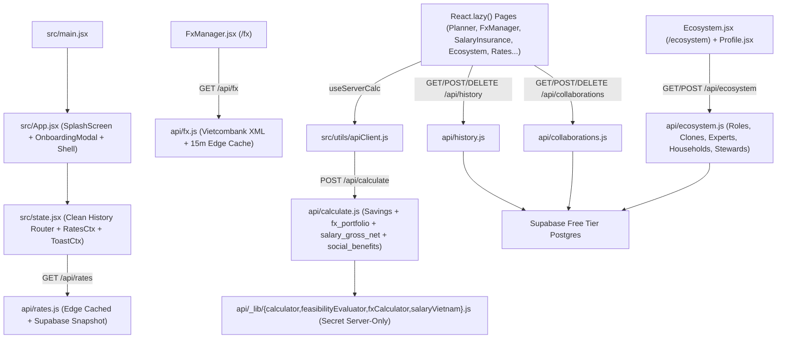

# VnSavingPro — Architecture & Technical Reference (v2.7.0.0 Living Wealth OS · 2.5D Sky Island Assets · 8 Growth Stages · Core-Linked Houses Lv.1–5 · 3D Miu Vang · Demo)

## 1. High-Level Architecture

## 2. Proprietary Algorithm Protection & Vercel Function Budget (`10 / 12`)

- **Zero Client Exposure**: `calculator.js`, `feasibilityEvaluator.js`, `householdAnalytics.js`, `fxRatesCache.js`, `fxCalculator.js`, `salaryVietnam.js`, and `supabase.js` (`SUPABASE_SERVICE_ROLE_KEY`) live exclusively inside `api/_lib/` and are **never imported by `src/`**. Production Vite bundles (`dist/assets/*.js`) are built with `sourcemap: false` and split into lazy chunks (`FxManager`, `SalaryInsurance`, `Ecosystem`, `supabase`, `charts`, etc.).
- **Supabase Free Tier Persistence (`supabase/schema.sql` + `20261123_v200_wealth_platform.sql`)**:
  - Tables: `bank_rate_snapshots`, `user_feedback`, `saved_plans`, `profiles` (extended with `account_role`, `is_verified_expert`, `expert_verification_status`, `expert_credentials`, `is_community_voted_planner`, `community_planner_score`, `community_total_votes`, `community_total_clones`, `steward_enabled`), `calculation_history` (`plan..inflation, fx, salary`), `household_collaborations`, `household_spaces`, `community_plan_templates`, `community_template_votes`, `steward_mandates`, `usage_quotas`, and `quota_alerts_log`.
- **10 Serverless Endpoints (`<= 12` Vercel Hobby Cap)**:
  - `GET /api/fx` ([api/fx.js](../../api/fx.js)): Rate-limited (`90 req/min`), fetches Vietcombank public XML ([fxRatesCache.js](../../api/_lib/fxRatesCache.js)) with 15-min memory/Edge CDN cache (`s-maxage=900, stale-while-revalidate=3600`) and Nov 2026 reference fallback.
  - `POST /api/calculate` ([api/calculate.js](../../api/calculate.js)): Handles `quick_estimate`, `planner_bundle`, `calculator_bundle`, `ladder`, `career`, `inflation`, `fx_portfolio` ([fxCalculator.js](../../api/_lib/fxCalculator.js)), `salary_gross_net`, `social_benefits` ([salaryVietnam.js](../../api/_lib/salaryVietnam.js)), and `cic_loan_bundle` ([cicAndLoanVietnam.js](../../api/_lib/cicAndLoanVietnam.js)).
  - `GET`/`POST /api/ecosystem` ([api/ecosystem.js](../../api/ecosystem.js)): Unified role/community hub (`templates`, `experts`, `clone_template`, `publish_template`, `vote_template`, `apply_expert`, `create_household`, `switch_couple`, `upgrade_couple_to_family`, `create_steward_mandate`, `accept_steward_mandate`, `sync_steward_snapshot`, `revoke_steward_mandate`). Protected actions enforce `401` Bearer verification.
  - Added `/blog` ([Blog.jsx](../../src/pages/Blog.jsx) + [blogData.js](../../src/data/blogData.js)) and `/referral` / `/rates?tab=security` ([Rates.jsx](../../src/pages/Rates.jsx) + [bankSecurityAndPerksData.js](../../src/data/bankSecurityAndPerksData.js)) with **0 additional Vercel functions** (`10 / 12`).
  - `GET /api/rates` ([api/rates.js](../../api/rates.js)), `GET/POST/DELETE /api/history`, `/api/plans`, `/api/collaborations`, `/api/feedback`, `/api/quota-status`, `/api/cron/sync-rates`.
- **Local Dev/Preview Parity (`vite.config.js`)**: `vercelApiPlugin()` intercepts all 10 routes including `/api/fx` and `/api/ecosystem`.

## 3. Routing & State Management (`src/state.jsx` & `src/tools.js`)

- **Routing (`useRoute`, `href`, `navigate`) & 3-Language i18n (`src/i18n/index.jsx`)**:
  - Single source of truth for page naming & URLs lives in `src/tools.js` (`HOME_PAGE` & `TOOLS` with `path`, `aliases`, and `pageTitle`) plus helpers `normalizePath()`, `resolveRouteId()`, `getRoutePath()`, `getLocalizedTools()`, `getLocalizedPageTitle()`, and `getLocalizedVersionHighlights()`.
  - `I18nProvider` (`src/i18n/index.jsx`) manages `lang` (`vi` | `en` | `ja`), persisted across `localStorage` (`vnsaving_lang`), `?lang=` query param, `vnsaving_prefs` cookie, and `<html lang>`, and syncs `setFormatLang()` (`src/utils/format.js`) so numbers/units render natively (`tỷ/triệu`, `B/M/K`, `億/万`) while `useServerCalc()` passes `lang` into `POST /api/calculate` and isolates cache keys per language.
  - Parses `window.location.pathname` and `window.location.search` into `{ route, params }` (e.g., `/`, `/plan?target=10000000&saving=5000000`, or Vietnamese aliases like `/ke-hoach`).
  - Automatically migrates legacy `#/...` URLs via `history.replaceState`, intercepts same-origin `<a>` clicks for zero-reload SPA transitions, syncs localized `document.title` per route, and scrolls to top on navigation/popstate.
- **Rates Context (`useRates`)**:
  - Fetches `/api/rates` on mount (falling back to `INITIAL_BANKS_DATA` + `RATES_UPDATED_AT`), merges with user-customized overrides stored in `localStorage` under `VNSAVING_SECURE_CUSTOM_RATES` via `cryptoStorage`.
  - Exposes: `banks`, `updatedAt`, `customRates`, `getRate`, `isCustom`, `setRate`, `resetRate`, `replaceAll`, and `best(tenure)`.
- **Cross-Tool Plan Continuity (`src/utils/apiClient.js`)**:
  - `loadSavedPlannerState()` reads `PLANNER_STATE` so `Calculator`, `Ladder`, `Career`, and `Inflation` pre-fill from the user's active financial plan.

## 4. Design System, Responsive Layout & App Versioning (`src/index.css`, `src/components/ui.jsx`, `src/version.json`)

- **Theme**: Dark-first financial dashboard (`bg-canvas` `#08090b`, `bg-surface` `#0e0f13`, `bg-elevated` `#16181d`, indigo/emerald accents, `Inter` font with `tabular-nums`).
  - **Silent Adaptive Multi-Screen Layout Engine (`src/layout/DisplayModeContext.jsx` & `src/components/AdaptiveLayout.jsx`, `src/index.css`)**:
    - `DisplayModeProvider` + pure `detectViewportMetrics()` silently and automatically classify devices into `mobile` (`<640px`), `tablet` (`640–1024px`, portrait stack vs. split `>=768px`), `duo` (Galaxy Z Fold, iPhone Duo/Fold, Pixel Fold, Surface Duo via W3C Viewport Segments API / `@media (horizontal-viewport-segments: 2)` & `(vertical-viewport-segments: 2)` plus near-square touch inner screen heuristic), or `desktop` (`>=1024px`).
    - All manual screen-mode selector UI controls ("Chọn chế độ màn hình") were removed in `v1.12.0.0`; layout adapts silently without exposing internal layout terminology to end users, reserving `?layout=` / `?posture=` query params strictly for QA verification.
    - Every page (`Home`, `Planner`, `Calculator`, `Ladder`, `Career`, `Inflation`, `Rates`, `Profile`) composes from unified primitives `PageContainer`, `WorkspaceSplit`, `DualPaneSection`, `AdaptiveGrid`, and `StickyResultBar` so layout improvements propagate uniformly across all screen types.
    - `overflow-x: clip` prevents horizontal overflow; Modals & Toasts dock into the right screen in Duo Book mode, anchor as bottom sheets in Mobile mode, and center on Tablet/Desktop.
  - **Streamlined Header, Branded Splash & 3-Step Onboarding (`src/components/Layout.jsx`, `SplashScreen.jsx`, `OnboardingModal.jsx`, `cryptoStorage.js`)**:
    - `TopNav` highlights **Lập kế hoạch** (gradient spotlight + live pulse indicator) and **Lãi suất** (live best 12M yield badge), keeps `Khám phá` (secondary tools + Quick Setup + Data/Cloud), `LanguageSwitcher`, and `UserMenu`.
    - `SplashScreen` renders an initial dark branded overlay (~700ms, ~120ms under `prefers-reduced-motion`) featuring waving **Mèo Chiêu Tài Miu Vàng** (`LuckyCatMascot`), `/logo.png`, version pill, and animated loading progress bar for all sessions (guest & authenticated).
    - `LuckyCatMascot` (`src/components/LuckyCatMascot.jsx`) provides the custom 0KB animated SVG Maneki-neko mascot (`wave`, `gardener`, `scholar`, `celebrate`, `cheer` moods), `<LuckyCatTipCard />` interactive pet-for-luck companion banner on Home, `<LuckyCatHeaderButton />` & `<LuckyCatFortuneModal />` (8 trilingual Daily Lucky Wealth Fortunes) in TopNav/Footer, plus gardener cheering inside `WealthTreeGarden`, `OnboardingModal`, and `Planner`.
    - `OnboardingModal` walks first-time users on `/` through Step 1 (Household Profile: Individual/Couple/Family) -> Step 2 (Primary Goal: Passive Income / Capital / Rates) -> Step 3 (Starter Figures / Bank Selection), persisted via validated `ONBOARDING_STATE` and `PLANNER_STATE` in `cryptoStorage.js` (`raw` schema validator).
  - **4-Part App Versioning (`src/version.json` + `scripts/bump-version.js` + `AGENTS.md`)**:
    - Uses `MAJOR.MINOR.PATCH.BUILD` starting at `1.6.0.0` (currently `2.7.0.0`), synced into [src/tools.js](../../src/tools.js) (`APP_VERSION`, `APP_VERSION_RAW`, `APP_VERSION_DATE`, `APP_VERSION_LABEL`, `VERSION_HIGHLIGHTS`) and [package.json](../../package.json) (`version` 3-part SemVer + `appVersion` 4-part, `engines.node = "24.x"`).
  - Run `npm run version:bump` (or `node scripts/bump-version.js [build|patch|minor|major]`) on every committed update.
- **Reusable Primitives & Run Workflow (`src/components/ui.jsx`, `src/components/SavePlanPromptCard.jsx`)**:
  - `NumberInput` manages `focused` + `draft` state so typing or clearing digits never jumps the cursor or locks on `0`.
  - `CalculationLoader` displays a sliding `.loading-bar`, spinner banner, and `ResultsSkeleton` shimmer while manual tool runs are executing (`minLoadingMs: 320`).
  - `WorkspaceSplit` + `StickyResultBar` (`AdaptiveLayout.jsx`) provide uniform `runAction` CTA footers, dirty-state alerts, and mobile sticky run buttons across all 4 display modes (`Mobile`, `Tablet`, `Duo`, `Desktop`).
  - `SavePlanPromptCard` displays a guest CTA prompt (*"Bạn muốn lưu và xem lại các kế hoạch & kết quả tính toán không?"*) firing `OPEN_AUTH_EVENT`, or confirms Profile run history when authenticated.
  - `@media print` in `src/index.css` expands scrollable tables and hides navigation/action controls for clean PDF printing.

## 5. Build, Security Hardening & Deployment (`vite.config.js`, `vercel.json`)

- **Vite 5** with `@vitejs/plugin-react`, `@tailwindcss/vite`, `build.sourcemap: false`, explicit manual chunks (`react`, `charts`, `supabase`), lazy dynamic import of `@supabase/supabase-js` ([supabaseClient.js](../../src/utils/supabaseClient.js) + [AuthContext.jsx](../../src/contexts/AuthContext.jsx) — omitted completely from guest initial page loads), idle/consent-deferred GTM ([cookieManager.js](../../src/utils/cookieManager.js)), and `viteSriPlugin()` generating `sha384` Subresource Integrity tags in `dist/index.html`.
- **HTTP Security & Caching Headers** (`vercel.json`, `vite.config.js`): Immutable 1-year `Cache-Control` for `/assets/(.*)`, plus `Content-Security-Policy`, `X-Frame-Options: DENY`, `X-Content-Type-Options: nosniff`, `Referrer-Policy: strict-origin-when-cross-origin`, `Permissions-Policy`, and `Strict-Transport-Security`.
- **Hardened Client Storage & Self-Healing (`src/utils/cryptoStorage.js` & `src/App.jsx`)**: Strict key allowlist (`CUSTOM_RATES`, `CUSTOM_REFERRAL_CODES`, `PLANNER_STATE`, `USER_FEEDBACK_LOG`, `CALC_HISTORY_LOG`, `TOOL_RESTORE_STATE`), signed cipher envelopes (`v2.<nonce>.<sig>.<cipherB64>`), circular-reference-safe JSON serialization, per-key schema & `Number.isFinite()` validation, XSS tag stripping, foreign-key flooding auto-purge, `safeExternalUrl()` protocol enforcement, and `AppErrorBoundary` recovery UI.
- **`vercel.json`**: Uses `"framework": "vite"`, excludes `/api/(.*)` from SPA rewrites (`"source": "/((?!api/).*)"`), and deploys serverless functions on Vercel Node 24 LTS without duplicate cron schedules.
