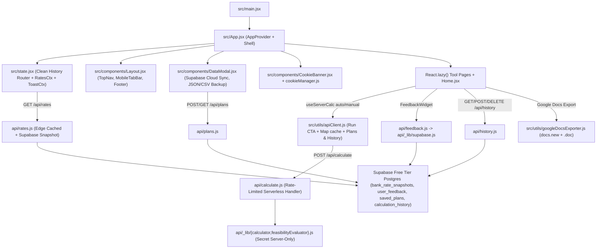

# VnSavingPro — Architecture & Technical Reference (v1.11.0.0 Free-Tier Optimized · Hardened RLS · Node 24 LTS)

## 1. High-Level Architecture

## 2. Proprietary Algorithm Protection (`api/_lib/` & `api/calculate.js`)

- **Zero Client Exposure**: `calculator.js`, `feasibilityEvaluator.js`, `householdAnalytics.js`, and `supabase.js` (`SUPABASE_SERVICE_ROLE_KEY`) live exclusively inside `api/_lib/` and are **never imported by `src/`**. Production Vite bundles (`dist/assets/*.js`) are built with `sourcemap: false` and contain only UI components and API requests.
- **Supabase Free Tier Persistence (`supabase/schema.sql` + `api/_lib/supabase.js`)**:
  - Zero-dependency server-side PostgREST client (`sbSelect`, `sbInsert`, `sbUpsert`) using native `fetch` with a 3.5s timeout and automatic fallback to in-memory/bundled defaults when `SUPABASE_URL` / keys are not yet configured.
  - Tables: `public.bank_rate_snapshots`, `public.user_feedback`, `public.saved_plans`, `public.profiles`, `public.calculation_history`, `public.usage_quotas`, and `public.quota_alerts_log` (protected with RLS policies).
- **Endpoints**:
  - `GET /api/rates` ([api/rates.js](../../api/rates.js)): Serves bank rates + `RATES_UPDATED_AT` + `syncSchedule: 'monthly_day_1'` + `pocValidationReached` + pre-computed `defaultQuickEstimate` (`vi`/`en`/`ja`) from `getLiveRatesSnapshotAsync()` (`public, s-maxage=86400, stale-while-revalidate=604800`, 6h memory cache; `?keepalive=1` bypasses cache with `no-store` for 5-day anti-pause pings).
  - `POST /api/calculate` ([api/calculate.js](../../api/calculate.js)): Handles `quick_estimate`, `planner_bundle`, `calculator_bundle`, `ladder`, `career`, and `inflation` with bounded per-IP sliding-window rate limiting ([rateLimit.js](../../api/_lib/rateLimit.js): `120 req/min`, capped `2000` IP entries).
  - `GET`/`POST`/`DELETE /api/history` ([api/history.js](../../api/history.js)): Rate-limited (`60 req/min`), authenticated endpoint (`401` if unauthenticated) storing and restoring calculation/plan run snapshots with automatic **50-row retention cap per user** in `calculation_history` (or per-user memory fallback).
  - `GET`/`POST /api/feedback` ([api/feedback.js](../../api/feedback.js)): Rate-limited (`60 GET/min`, `30 POST/min`). `GET /api/feedback?public=1` is CDN cached (`s-maxage=300`) returning anonymized contributor notes with financial numbers stripped; raw admin `GET /api/feedback` strictly requires `CRON_SECRET` or `SUPABASE_SERVICE_ROLE_KEY` Bearer authorization (`401`). Direct `anon`/`authenticated` Postgres `INSERT` is revoked.
  - `GET`/`POST`/`DELETE /api/plans` ([api/plans.js](../../api/plans.js)): Rate-limited (`90 GET/min`, `40 write/min`). Saves and loads sanitized financial plans using 6–12 character share codes (`saved_plans` via `service_role`; unauthenticated `anon` direct Data API access is revoked).
  - `GET /api/quota-status` ([api/quota-status.js](../../api/quota-status.js)) & [quotaGuard.js](../../api/_lib/quotaGuard.js) + [resend.js](../../api/_lib/resend.js): Monitors Free-Tier caps with batched telemetry (`CACHE_WINDOW_MS = 300s`, `BATCH_HIT_FLUSH = 50`), CDN caches public status for `300s`, sends deduplicated Resend alerts at **80%, 90%, 95%, and 100%**, and triggers `503 POC_QUOTA_REACHED` when capped.
  - `GET /api/cron/sync-rates` ([api/cron/sync-rates.js](../../api/cron/sync-rates.js)): Protected webhook/manual scraper endpoint (`CRON_SECRET`) that persists updated bank rate snapshots and retains the newest 24 snapshots.
- **Automated Monthly 1st (9:00 AM) Rate Scrapers & 5-Day Keepalive (`scripts/` & `.github/workflows/`)**:
  - `scripts/scrape-tnex.js`, `scripts/scrape-timo.js`, `scripts/scrape-liobank.js`, `scripts/scrape-cake.js`, and `scripts/scrape-all.js` pull official public tariffs + promo PDFs/terms and push snapshots directly to Supabase when credentials are set in GitHub Actions secrets.
  - `.github/workflows/daily-rates-sync.yml` runs once monthly on **Node.js 24 LTS** (`0 2 1 * *` UTC = 09:00 AM UTC+7 on Day 1) as the single source of truth (duplicate `vercel.json` `crons` removed); `scripts/register-daily-9am-task.ps1` registers the local Windows equivalent.
  - `.github/workflows/keepalive-supabase.yml` runs every 5 days (`0 3 */5 * *`) pinging `/api/rates?keepalive=1` so Supabase Free Tier stays `ACTIVE_HEALTHY` despite monthly rate updates.
- **Local Dev/Preview Parity (`vite.config.js`)**: `loadEnv` loads server-only keys into `process.env` and `vercelApiPlugin()` intercepts `/api/rates`, `/api/calculate`, `/api/feedback`, `/api/plans`, `/api/history`, `/api/quota-status`, and `/api/cron/sync-rates` during `vite dev` and `vite preview`.

## 3. Routing & State Management (`src/state.jsx` & `src/tools.js`)

- **Routing (`useRoute`, `href`, `navigate`) & 3-Language i18n (`src/i18n/index.jsx`)**:
  - Single source of truth for page naming & URLs lives in `src/tools.js` (`HOME_PAGE` & `TOOLS` with `path`, `aliases`, and `pageTitle`) plus helpers `normalizePath()`, `resolveRouteId()`, `getRoutePath()`, `getLocalizedTools()`, `getLocalizedPageTitle()`, and `getLocalizedVersionHighlights()`.
  - `I18nProvider` (`src/i18n/index.jsx`) manages `lang` (`vi` | `en` | `ja`), persisted across `localStorage` (`vnsaving_lang`), `?lang=` query param, `vnsaving_prefs` cookie, and `<html lang>`, and syncs `setFormatLang()` (`src/utils/format.js`) so numbers/units render natively (`tỷ/triệu`, `B/M/K`, `億/万`) while `useServerCalc()` passes `lang` into `POST /api/calculate` and isolates cache keys per language.
  - Parses `window.location.pathname` and `window.location.search` into `{ route, params }` (e.g., `/`, `/plan?target=10000000&saving=5000000`, or Vietnamese aliases like `/ke-hoach`).
  - Automatically migrates legacy `#/...` URLs via `history.replaceState`, intercepts same-origin `<a>` clicks for zero-reload SPA transitions, syncs localized `document.title` per route, and scrolls to top on navigation/popstate.
- **Rates Context (`useRates`)**:
  - Fetches `/api/rates` on mount (falling back to `INITIAL_BANKS_DATA` + `RATES_UPDATED_AT`), merges with user-customized overrides stored in `localStorage` under `VNSAVING_SECURE_CUSTOM_RATES` via `cryptoStorage`.
  - Exposes: `banks`, `updatedAt`, `customRates`, `getRate`, `isCustom`, `setRate`, `resetRate`, `replaceAll`, and `best(tenure)`.
- **Cross-Tool Plan Continuity (`src/utils/apiClient.js`)**:
  - `loadSavedPlannerState()` reads `PLANNER_STATE` so `Calculator`, `Ladder`, `Career`, and `Inflation` pre-fill from the user's active financial plan.

## 4. Design System, Responsive Layout & App Versioning (`src/index.css`, `src/components/ui.jsx`, `src/version.json`)

- **Theme**: Dark-first financial dashboard (`bg-canvas` `#08090b`, `bg-surface` `#0e0f13`, `bg-elevated` `#16181d`, indigo/emerald accents, `Inter` font with `tabular-nums`).
- **Unified Multi-Screen Adaptive Layout Engine (`src/layout/DisplayModeContext.jsx` & `src/components/AdaptiveLayout.jsx`, `src/index.css`)**:
  - `DisplayModeProvider` + pure `detectViewportMetrics()` automatically classifies devices into `mobile` (`<640px`), `tablet` (`640–1024px`, portrait stack vs. split `>=768px`), `duo` (Galaxy Z Fold, iPhone Duo/Fold, Pixel Fold, Surface Duo via W3C Viewport Segments API / `@media (horizontal-viewport-segments: 2)` & `(vertical-viewport-segments: 2)` plus near-square touch inner screen heuristic), or `desktop` (`>=1024px`).
  - Users can switch layout explicitly via **Auto | Mobile | Tablet | Duo / Fold | PC/Desktop** (`DisplayModeSwitcher` in `TopNav`, `MobileTabBar` sheet, `Footer`, and `Profile`) and toggle Duo postures between **Book** (side-by-side 2 panes avoiding vertical fold crease `--duo-hinge-gap`) and **Flex / Tabletop** (results pinned on top pane, controls on bottom pane).
  - Every page (`Home`, `Planner`, `Calculator`, `Ladder`, `Career`, `Inflation`, `Rates`, `Profile`) composes from unified primitives `PageContainer`, `WorkspaceSplit`, `DualPaneSection`, `AdaptiveGrid`, and `StickyResultBar` so layout changes propagate uniformly across all screen types.
  - `overflow-x: clip` prevents horizontal overflow; Modals & Toasts dock into the right screen in Duo Book mode, anchor as bottom sheets in Mobile mode, and center on Tablet/Desktop.
- **4-Part App Versioning (`src/version.json` + `scripts/bump-version.js` + `AGENTS.md`)**:
  - Uses `MAJOR.MINOR.PATCH.BUILD` starting at `1.6.0.0` (currently `1.11.0.0`), synced into [src/tools.js](../../src/tools.js) (`APP_VERSION`, `APP_VERSION_RAW`, `APP_VERSION_DATE`, `APP_VERSION_LABEL`, `VERSION_HIGHLIGHTS`) and [package.json](../../package.json) (`version` 3-part SemVer + `appVersion` 4-part, `engines.node = "24.x"`).
  - Run `npm run version:bump` (or `node scripts/bump-version.js [build|patch|minor|major]`) on every committed update.
- **Reusable Primitives & Run Workflow (`src/components/ui.jsx`, `src/components/SavePlanPromptCard.jsx`)**:
  - `NumberInput` manages `focused` + `draft` state so typing or clearing digits never jumps the cursor or locks on `0`.
  - `CalculationLoader` displays a sliding `.loading-bar`, spinner banner, and `ResultsSkeleton` shimmer while manual tool runs are executing (`minLoadingMs: 320`).
  - `WorkspaceSplit` + `StickyResultBar` (`AdaptiveLayout.jsx`) provide uniform `runAction` CTA footers, dirty-state alerts, and mobile sticky run buttons across all 4 display modes (`Mobile`, `Tablet`, `Duo`, `Desktop`).
  - `SavePlanPromptCard` displays a guest CTA prompt (*"Bạn muốn lưu và xem lại các kế hoạch & kết quả tính toán không?"*) firing `OPEN_AUTH_EVENT`, or confirms Profile run history when authenticated.
  - `@media print` in `src/index.css` expands scrollable tables and hides navigation/action controls for clean PDF printing.

## 5. Build, Security Hardening & Deployment (`vite.config.js`, `vercel.json`)

- **Vite 5** with `@vitejs/plugin-react`, `@tailwindcss/vite`, `build.sourcemap: false`, explicit manual chunks (`react`, `charts`, `supabase`), lazy dynamic import of `@supabase/supabase-js` ([supabaseClient.js](../../src/utils/supabaseClient.js) + [AuthContext.jsx](../../src/contexts/AuthContext.jsx) — omitted completely from guest initial page loads), idle/consent-deferred GTM ([cookieManager.js](../../src/utils/cookieManager.js)), and `viteSriPlugin()` generating `sha384` Subresource Integrity tags in `dist/index.html`.
- **HTTP Security & Caching Headers** (`vercel.json`, `vite.config.js`): Immutable 1-year `Cache-Control` for `/assets/(.*)`, plus `Content-Security-Policy`, `X-Frame-Options: DENY`, `X-Content-Type-Options: nosniff`, `Referrer-Policy: strict-origin-when-cross-origin`, `Permissions-Policy`, and `Strict-Transport-Security`.
- **Hardened Client Storage & Self-Healing (`src/utils/cryptoStorage.js` & `src/App.jsx`)**: Strict key allowlist (`CUSTOM_RATES`, `CUSTOM_REFERRAL_CODES`, `PLANNER_STATE`, `USER_FEEDBACK_LOG`, `CALC_HISTORY_LOG`, `TOOL_RESTORE_STATE`), signed cipher envelopes (`v2.<nonce>.<sig>.<cipherB64>`), circular-reference-safe JSON serialization, per-key schema & `Number.isFinite()` validation, XSS tag stripping, foreign-key flooding auto-purge, `safeExternalUrl()` protocol enforcement, and `AppErrorBoundary` recovery UI.
- **`vercel.json`**: Uses `"framework": "vite"`, excludes `/api/(.*)` from SPA rewrites (`"source": "/((?!api/).*)"`), and deploys serverless functions on Vercel Node 24 LTS without duplicate cron schedules.
