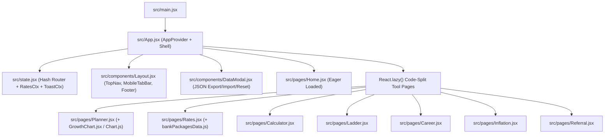

# VnSavingPro — Architecture & Technical Reference (v2)

## 1. High-Level Architecture

## 2. Routing & State Management (`src/state.jsx`)

- **Hash Router (`useRoute`, `href`)**:
  - Parses `window.location.hash` into `{ route, params }` (e.g., `#/plan?target=10000000&saving=5000000` -> `route: 'plan'`, `params: { target: '10000000', saving: '5000000' }`).
  - Scrolls to top automatically on `hashchange`.
  - Works on any static host (Vercel, GitHub Pages, Cloudflare Pages) without requiring server-side route rewrites.
- **Rates Context (`useRates`)**:
  - Merges static baseline bank rates (`INITIAL_BANKS_DATA` from `src/data/banksData.js`) with user-customized overrides stored in `localStorage` under `VNSAVING_SECURE_CUSTOM_RATES` via `cryptoStorage`.
  - Exposes: `banks`, `customRates`, `getRate(bank, tenure)`, `isCustom(bank, tenure)`, `setRate(bank, tenure, value)`, `resetRate(bank, tenure)`, `replaceAll(next)`, and `best(tenure)`.
- **Toast Context (`useToast`)**:
  - Lightweight 2.4-second notification banner at bottom of viewport.

## 3. Design System (`src/index.css` & `src/components/ui.jsx`)

- **Theme**: Dark-first financial dashboard (`bg-canvas` `#08090b`, `bg-surface` `#101216`, `bg-elevated` `#161920`, indigo/emerald accents, `Inter` font with `tabular-nums` for numbers).
- **Reusable Primitives (`src/components/ui.jsx`)**:
  - `Card` & `CardHeader`: Bordered translucent dark surfaces (`border-white/[0.07] bg-surface/90`).
  - `Button`: Variants `primary` (indigo), `secondary`, `ghost`, `danger`; polymorphic via `as="a"`.
  - `Badge`: Tones `neutral`, `brand`, `success`, `warning`, `danger`.
  - `Chip` & `Segmented`: Preset selectors and view toggles.
  - `MoneyField`: Combined formatted VND text input + range slider + preset chips.
  - `DecimalInput`, `NumberInput`, `SliderField`: Controlled numeric inputs with suffix labels.
  - `Stat`, `Progress`, `Callout`, `Table`, `Modal`, `PageHeader`, `BankMark`.

## 4. Build & Bundling (`vite.config.js`)

- **Vite 5** with `@vitejs/plugin-react` and `@tailwindcss/vite` (Tailwind v4).
- **Manual Chunks**:
  - `react`: `['react', 'react-dom']`
  - `charts`: `['chart.js', 'react-chartjs-2']` (only loaded when visiting `#/plan` since `Planner.jsx` is lazy-loaded).
- **Deployment Configs**:
  - `vercel.json`: Currently uses legacy `"builds": ["@vercel/static-build"]` — scheduled to be modernized to `"framework": "vite"` in the GitHub/Vercel deployment plan.
  - `wrangler.jsonc`: Cloudflare Pages static assets config (`./dist`).
